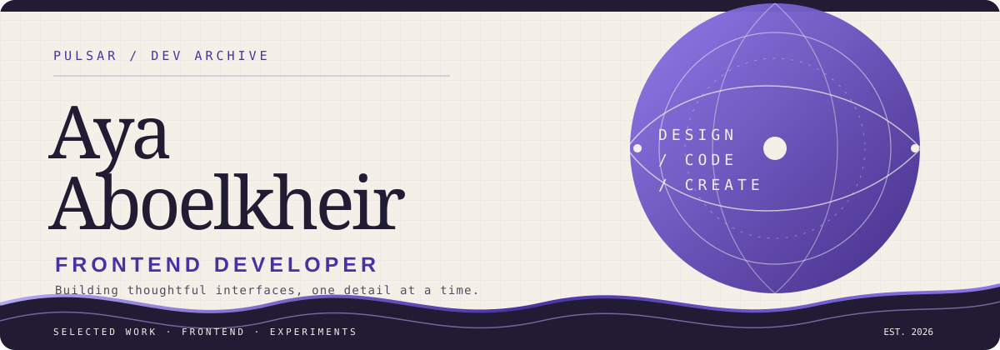

  

  <h3>Turning ideas into thoughtful digital experiences.</h3>
  
Frontend Developer · Egypt

  

    
    
  

---

## // About

I'm a Frontend Developer who enjoys turning ideas into modern, responsive, and user-friendly web applications. I like working across the details that make an interface feel complete — from layout and interaction to reusable components and API-driven content.

I'm continuously learning, experimenting with tools, and building projects that help me grow as a developer.

## // Tech stack

  

## // What I build

<table>
  <tr>
    <td width="50%">
      <strong>01 / Responsive interfaces</strong> 
      Layouts that adapt cleanly across screen sizes.
    </td>
    <td width="50%">
      <strong>02 / Interactive web apps</strong> 
      Dynamic interfaces with JavaScript and React.
    </td>
  </tr>
  <tr>
    <td width="50%">
      <strong>03 / E-commerce experiences</strong> 
      Product browsing, filtering, carts, and wishlists.
    </td>
    <td width="50%">
      <strong>04 / API integration</strong> 
      Fetching, handling, and presenting external data.
    </td>
  </tr>
</table>

## // Selected work

<table>
  <tr>
    <td width="50%" valign="top">
      <h3>01 — ShopSphere</h3>
      
A modern e-commerce frontend with product discovery, product details, cart, wishlist, and Arabic/English interface support.

      
React · Vite · Tailwind CSS · MUI

      <a href="https://github.com/aya-aboelkheir/ShopSphere">Explore repository ↗</a> · <a href="https://shop-sphere-three-weld.vercel.app/">Live demo ↗</a>
    </td>
    <td width="50%" valign="top">
      <h3>02 — VALENTINO Jewellery</h3>
      
A multi-page jewellery storefront with collections, product discovery, search, wishlist, and shopping cart experiences.

      
HTML · CSS · JavaScript

      <a href="https://github.com/aya-aboelkheir/VALENTINO-Jewellery">Explore repository ↗</a>
    </td>
  </tr>
  <tr>
    <td width="50%" valign="top">
      <h3>03 — React To-Do App</h3>
      
A task manager built around reusable React components, context-based state, task actions, and interface feedback.

      
React · Vite · Tailwind CSS · MUI · Context API

      <a href="https://github.com/aya-aboelkheir/React-To-Do-App">Explore repository ↗</a>
    </td>
    <td width="50%" valign="top">
      <h3>04 — My Portfolio</h3>
      
A personal portfolio website presenting my background, services, selected work, and contact information.

      
HTML · CSS · JavaScript

      <a href="https://github.com/aya-aboelkheir/My_Portfolio">Explore repository ↗</a>
    </td>
  </tr>
</table>

## // More experiments

A collection of smaller projects and learning exercises:

- [Weather App](https://github.com/aya-aboelkheir/weather-app) — weather data with an external API
- [DOM & Bootstrap Project](https://github.com/aya-aboelkheir/DOM_project) — dynamic product rendering with Fetch API
- [QuickSort with GitHub Copilot](https://github.com/aya-aboelkheir/QuickSort-Copilot) — algorithm implementation, tests, and performance exploration
- [Quiz App](https://github.com/aya-aboelkheir/Quiz-App) — interactive quiz and score flow
- [Password Generator](https://github.com/aya-aboelkheir/Password-Generator) — configurable-style password generation practice
- [JavaScript To-Do App](https://github.com/aya-aboelkheir/To-Do-App) — task management with vanilla JavaScript
- [HTML & CSS Project](https://github.com/aya-aboelkheir/html-css-project) — responsive company website

## // GitHub field notes

  
  

  

---

  <strong>Thanks for stopping by.</strong> 
  Keep learning. Keep building. Keep refining.

