  

**I build responsive interfaces and interactive web experiences.**

[LinkedIn](https://www.linkedin.com/in/aya-aboelkheir-70a1b9357/) · [GitHub](https://github.com/aya-aboelkheir)

---

## About

I'm a Frontend Developer who enjoys turning ideas into modern, responsive, and user-friendly web applications. I work with HTML, CSS, JavaScript, and React, and I like building real projects that bring together clean interfaces, useful interactions, and dynamic data.

## Technical skills

  

The bars represent an indicative project-exposure index based on the technologies and implementation depth visible across my public repositories — not a test or a claim of professional proficiency.

  

## Selected work

| Project | What I built | Stack |
|---|---|---|
| [ShopSphere](https://github.com/aya-aboelkheir/ShopSphere) · [Live](https://shop-sphere-three-weld.vercel.app/) | E-commerce frontend with product catalog, search, filters, product details, cart, wishlist, and Arabic/English support | React · Vite · Tailwind CSS · MUI |
| [VALENTINO Jewellery](https://github.com/aya-aboelkheir/VALENTINO-Jewellery) | Multi-page jewellery storefront with collections, search, cart, and wishlist | HTML · CSS · JavaScript |
| [React To-Do App](https://github.com/aya-aboelkheir/React-To-Do-App) | Task manager with reusable components, Context API, state handling, and dialogs | React · Vite · Tailwind CSS · MUI |
| [My Portfolio](https://github.com/aya-aboelkheir/My_Portfolio) | Personal portfolio website | HTML · CSS · JavaScript |

## More projects

- [Weather App](https://github.com/aya-aboelkheir/weather-app) — API-powered weather application
- [DOM & Bootstrap Project](https://github.com/aya-aboelkheir/DOM_project) — dynamic product rendering with Fetch API
- [QuickSort with GitHub Copilot](https://github.com/aya-aboelkheir/QuickSort-Copilot) — algorithm implementation, tests, and performance exploration
- [Quiz App](https://github.com/aya-aboelkheir/Quiz-App) — interactive quiz and score flow
- [Password Generator](https://github.com/aya-aboelkheir/Password-Generator) — JavaScript password generator
- [JavaScript To-Do App](https://github.com/aya-aboelkheir/To-Do-App) — task manager with vanilla JavaScript
- [HTML & CSS Project](https://github.com/aya-aboelkheir/html-css-project) — responsive company website
- [React Portfolio](https://github.com/aya-aboelkheir/portfolio-react) — portfolio built with React and Tailwind CSS

## GitHub activity

  
  

  

---

**Thanks for visiting — more projects and experiments coming soon.**

